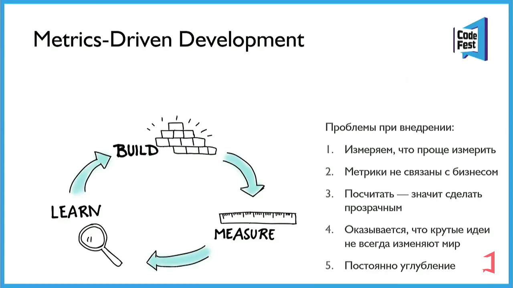
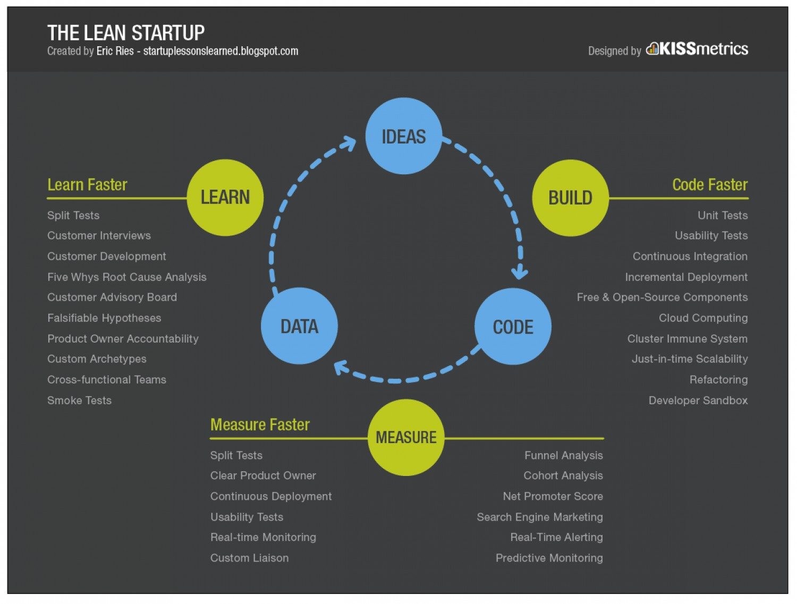

# Бизнес аналитик

## Зачем нужен бизнес аналитик

- Понимание [бизнес целей и задач компании](analytica.bt.md#цели)
- Анализ и оптимизация [бизнес процессов](bp.md), документирование в [BPMN](bp.bpmn.md)
- [Сбор и документирование бизнес требований к продукту](analytica.bt.md#сбор-требований)

[TODO](https://practicum.yandex.ru/blog/professiya-biznes-analitika/)

## Metrics Driven Development, Lean Startup

- [Customer journey mapping](cjm.md) клиентский путь
  - [mermaid](https://mermaid-js.github.io/mermaid/#/./user-journey)
- В основе концепции __Lean startup__ лежит цикл обратной связи __создать-оценить-научиться__
  - Важнейшая задача и суть управления стартапом — стремиться __сокращать время цикла обратной связи__
- Бизнес метрики, посчитать как сейчас, что будет
- Мнение заказчика по гипотезам-проблемам с ценностью
- __Критерии успеха__ бизнес инициативы Goal Question Metric model
- __Продуктовые метрики качества__
- Непрерывная добыча данных
- Каждая задача должна быть оценена в деньгах бизнесом: __гипотеза ценности и гипотеза роста__
- Разрабатывайте полноценную версию фичи после подтверждения ее эффективности через MVP
