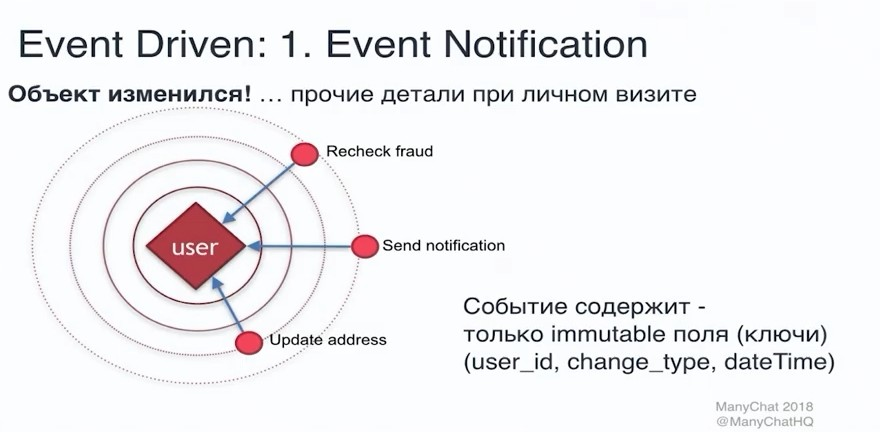
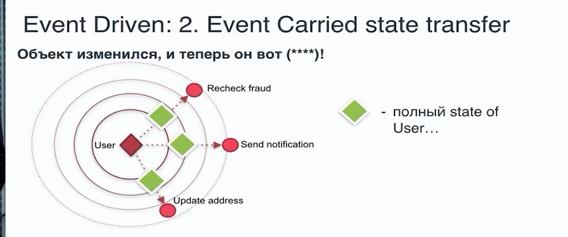

# Event Driven Architecture (EDA) Событийно ориентированная архитектура

- [Event Driven Architecture (EDA) Событийно ориентированная архитектура](#event-driven-architecture-eda-событийно-ориентированная-архитектура)
  - [Зачем](#зачем)
  - [Плюсы и минусы](#плюсы-и-минусы)
  - [Паттерны](#паттерны)
  - [Технологии](#технологии)
  - [TODO](#todo)

## Зачем

[Архитектурный стиль](../arch.styles.md):

- __Несколько подсистем__ должны обрабатывать __одни и те же события__
- Обработка в режиме __реального времени с минимальной задержкой__
- Обработка сложных событий, например, поиск закономерностей или агрегирование данных по временным интервалам
- __Большие объемы__ и __высокая скорость поступления данных__ (характерно, например, для интернета вещей — IoT)
- __[Background Jobs](../../pattern/development/background.job.md)__: Sending background messages, emails, or notifications to loads of users.
- __Асинхронный обмен сообщениями__: [Очереди сообщений](../../pattern/integration/pattern.messagebroker.md) — лучший способ реализации асинхронного программирования.
- __Большое время отклика__: Ситуации, когда время выполнения запроса оказывается слишком долгим (например, при выполнении вычислений, поиске, создании PDF-файлов и т. д.).

## Плюсы и минусы

[Критерии](../../arch.criteria.md)

Плюсы:

- __Слабая связанность__ ([Low Coupling](https://habr.com/ru/post/706630/))
  - Это позволяет производителям событий создавать события, не зная о том, кто будет потреблять эти события
  - Потребители событий не должны знать об источниках событий
  - Модули, потребляющие события, и модули, создающие события, могут быть реализованы на разных языках или использовать разные технологии, подходящие для конкретных задач
  - Подсистемы получают независимые представления потока событий
  - Отправители и получатели независимы друг от друга
  - Нет интеграции "точка — точка". Очень легко добавлять в систему новые объекты-получатели
  - Гибкость
- __Масштабируемость__. [Производительность](https://habr.com/ru/company/oleg-bunin/blog/310418/)
- Объекты-получатели могут реагировать на события сразу при их поступлении

Минусы:

- [Обеспечить последовательность событий](https://docs.microsoft.com/ru-ru/azure/architecture/guide/architecture-styles/event-driven)
  - RMQ __не гарантирует порядок сообщений__, как вариант
    - для этого таймметка и ключ идемпотентности и порядок обработки на стороне ИС потребителя реализовать
    - или Kafka
- Асинхронный обмен сообщениями и __итоговая согласованность__
- Управляемость
- Взаимодействие между службами
- Гарантированная доставка
- Сложность реализации
- Сложность тестирования

## Паттерны

- две топологии
  - Топология «посредник» (__mediator topology__) часто применяется в тех случаях, когда необходимо обеспечить __[оркестрацию](../../pattern/integration/orchestration-choreography.md)__ нескольких этапов обработки события посредством центрального посредника.
  - __broker topology__ (__хореография__) is used when you want to chain events together without the use of a central mediator
- __Событие__ Event driven
  - [Publish-subscribe](../../../technology/middleware/messagebus/rmq.md)
    - event-base
    - [shared-data space](https://apolomodov.medium.com/coa-distributed-systems-4th-ed-2-architecture-af563b2332bd)
  - Подходы к передаче событий
    - только __факт события__ 
    - __полное состояние объекта__ 
- __Команда__ Command driven
  - [Task (Worker) Queue](../../../technology/middleware/messagebus/rmq.md)
  - [RPC (команды)](../../../technology/middleware/messagebus/rmq.md)
- __Запросы и команды отдельно__ [CQRS](../../pattern/performance/pattern.cqrs.md) - command query request segregation
- Состояние объекта - __последовательность событий изменений объекта__ [Event sourcing](../../pattern/integration/event.sourcing.md)
- __Распределенные транзакции__ (лучше не делать)
  - [SAGA](../../pattern/integration/pattern.saga.md)
  - [2PC](../../pattern/integration/pattern.2pc.md) двухфазный комит
- [Versioning Message](https://www.youtube.com/watch?v=mEzYTuYSork&list=PLx8uyNNs1ri2MBx6BjPum5j9_MMdIfM9C&index=11&ab_channel=ChrisPatterson)
  - [EasyNetQ by message type](https://github.com/EasyNetQ/EasyNetQ/wiki/Versioning-Messages)

## Технологии

- Шины сообщений Message Bus\Шины событий Event Bus (брокер обмена сообщениями [Message Broker](../../pattern/integration/pattern.messagebroker.md))
- [MS Обмен сообщениями](https://docs.microsoft.com/ru-ru/azure/architecture/guide/technology-choices/messaging)

## TODO

- <https://habr.com/ru/company/itsumma/blog/416629/>
- <https://habr.com/ru/post/422151/>
- <https://habr.com/ru/post/150134/>
- <https://docs.microsoft.com/ru-ru/azure/architecture/guide/architecture-styles/event-driven>
- pattern TODO
  - <https://github.com/plantuml-stdlib/EIP-PlantUML>
  - <https://medium.com/@objectzen/content-enricher-pattern-in-rabbitmq-eae504a8504e>
  - <http://rubyamqp.info/articles/patterns_and_use_cases.html>
  - <https://www.enterpriseintegrationpatterns.com/patterns/messaging/MessageRoutingIntro.html>
  - <https://www.rabbitmq.com/tutorials/tutorial-two-python.html>
  - <https://blog.rnds.pro/019-poison2>
  - <https://alexandrugris.github.io/distributed/systems/2017/06/03/rabbitmq-patterns.html>
  - <https://www.cloudamqp.com/docs/delayed-messages.html>
  - <https://solace.com/blog/messaging-patterns-for-event-driven-microservices/>
- naming
  - <https://solace.com/blog/designing-and-naming-topics-for-event-driven-architecture-with-pubsub/?mkt_tok=MDcyLUNCSS05MjUAAAGDJ7N-6jFCOwXRBzE_4Ku_niXJQniSVNAJ-nNBD0JvROkzqo3tQbzDTFFx5PHlhTJj16lqF8xZCHb8IIy_29iOyZFYViJCWwpsU1X393ljZGzf>&ю
  - <https://docs.solace.com/Best-Practices/Topic-Architecture-Best-Practices.htm>
  - <https://codeopinion.com/message-naming-guidelines/>
  - <https://stackoverflow.com/questions/32220312/rabbitmq-amqp-best-practice-queue-topic-design-in-a-microservice-architecture>
  - <http://thoai-nguyen.blogspot.com/2012/05/rabbitmq-exchange-queue-name-convention.html>
