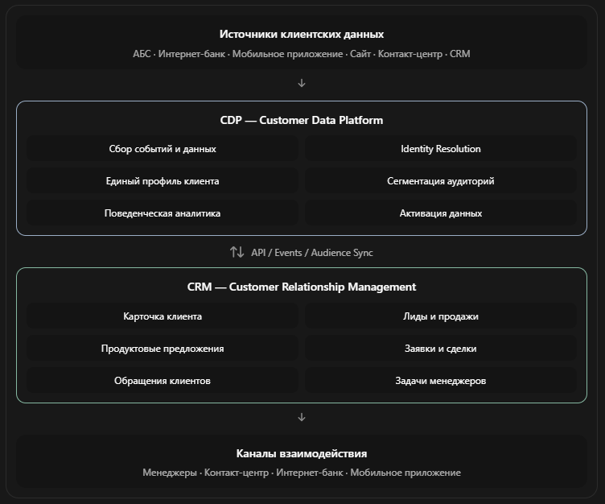

# Client Data Platform CDP

## Зачем

Собирает, объединяет и анализирует __клиентские данные__ из разных источников, __формирует единый профиль клиента__ и предоставляет аудитории и данные для персонализации.

Ключевое отличие: [CRM](crm.md) управляет клиентскими процессами, а CDP — клиентскими данными и их использованием для аналитики и персонализации.

## Технологии

- [MindBox](../../technology/cdp/mindbox.md)
