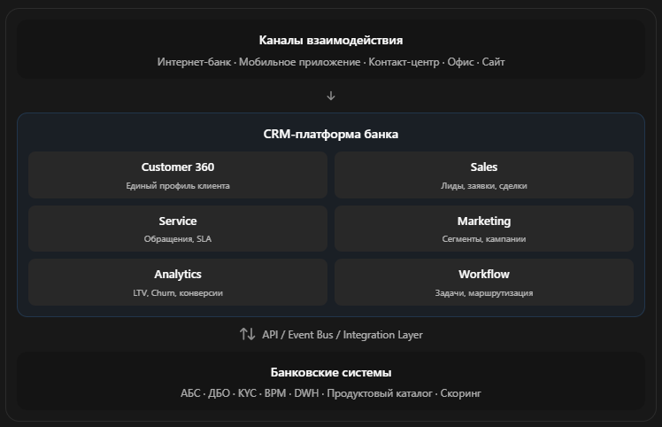
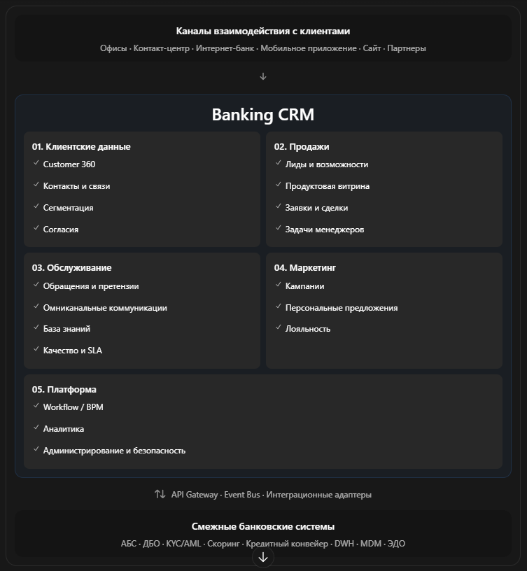

# Customer Relationship Management (CRM)

## Зачем

CRM (Customer Relationship Management) — система управления взаимоотношениями с клиентами, предназначенная для автоматизации продаж, маркетинга, обслуживания клиентов и анализа клиентских данных.

## Виды CRM по бизнес-направлению

Классифицируют по обслуживаемому бизнес-процессу.

| Вид                  | Назначение                    | Типовые функции                                         |
| -------------------- | ----------------------------- | ------------------------------------------------------- |
| Sales CRM            | Управление продажами          | Лиды, сделки, воронки, прогноз продаж                   |
| Marketing CRM        | Управление маркетингом        | Сегментация, кампании, триггерные коммуникации          |
| Service CRM          | Клиентское обслуживание       | Обращения, SLA, претензии, база знаний                  |
| Customer Success CRM | Развитие и удержание клиентов | Онбординг, Health Score, удержание, продление договоров |
| Partner CRM (PRM)    | Работа с партнерами           | Партнерские сделки, вознаграждения, каналы продаж       |
| Industry CRM         | Отраслевые процессы           | Специфические модели и бизнес-процессы отрасли          |

## Виды CRM по способу развертывания

| Вид               | Описание                                    | Особенности                                                             |
| ----------------- | ------------------------------------------- | ----------------------------------------------------------------------- |
| Cloud CRM (SaaS)  | Размещается в облаке поставщика             | Быстрое внедрение, подписка, меньше инфраструктурных задач              |
| On-Premise CRM    | Размещается в инфраструктуре компании       | Контроль инфраструктуры и данных, повышенные требования к сопровождению |
| Private Cloud CRM | Размещается в выделенном облачном окружении | Гибкость инфраструктуры, контроль изоляции и настроек                   |
| Hybrid CRM        | Комбинация облачных и локальных компонентов | Возможность разделения функций и данных между средами                   |

## Пример CRM в банковской сфере

Для банка CRM обычно представляет собой комплексную платформу, объединяющую операционные, аналитические и коммуникационные возможности.

В такой архитектуре CRM не обязательно является мастер-системой всех клиентских данных. Например, счета и остатки могут храниться в АБС, а CRM получает их через API или интеграционные события.

[Модули и функции](crm.bank.func.md)

## Какие сущности характерны для CRM

С точки зрения системного анализа можно выделить базовую доменную модель:

| Сущность    | Назначение                                            |
| ----------- | ----------------------------------------------------- |
| Customer    | Клиент (ФЛ или ЮЛ)                                    |
| Contact     | Контактное лицо                                       |
| Lead        | Потенциальный клиент или интерес                      |
| Opportunity | Потенциальная сделка                                  |
| Product     | Продукт или услуга                                    |
| Application | Заявка на продукт                                     |
| Interaction | История взаимодействий                                |
| Activity    | Задача, звонок, встреча                               |
| Case        | Обращение клиента                                     |
| Campaign    | Маркетинговая кампания                                |
| Consent     | Согласие клиента на обработку данных или коммуникации |

Для проектирования CRM я бы рекомендовал рассматривать три основных функциональных контура: Sales, Service и Marketing.
Customer 360, Analytics, Workflow и Integration Layer целесообразно выделить как общие платформенные возможности.

## Технологии

Для не банков (облачные варианты допустимы):

- [Bitrix24](../../technology/crm/bitrix24.md), ELMA356

Для [банков варианты](https://docs.google.com/document/d/1ZXkbGv8rGABrY57CxAQ1pG4REIVBTA3pQc4yyoqEGSQ/edit?usp=sharing) (on premies по 152 ФЗ):

- FIS Platform, Dynamika CRM (oCRM), FORA CRM Platform, НОТА МОДУС
