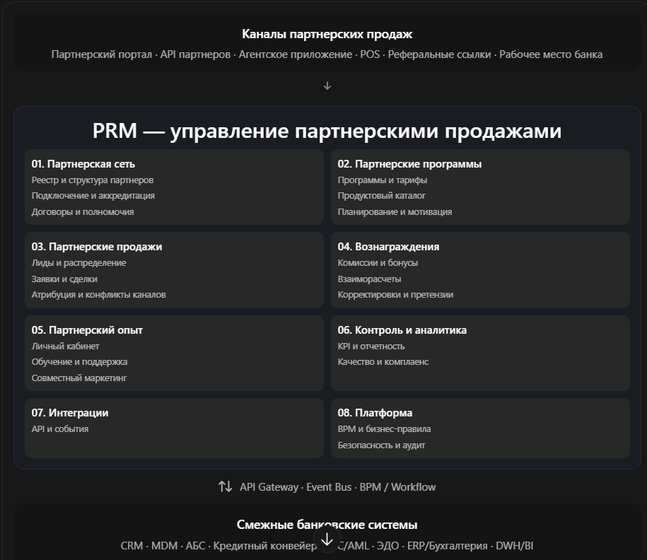

# Partner Relationship Management (PRM) Работа с партнерами

- [Partner Relationship Management (PRM) Работа с партнерами](#partner-relationship-management-prm-работа-с-партнерами)
	- [Зачем](#зачем)
	- [Функции](#функции)
	- [Границы ответственности PRM и смежных систем](#границы-ответственности-prm-и-смежных-систем)
	- [Технологии](#технологии)

## Зачем

[Класс систем](system.class.md) PRM - функциональный домен [CRM](crm.md), предназначенный для управления партнерской сетью банка, привлечением клиентов через партнеров, совместными продажами, партнерскими программами и вознаграждениями.

## Функции

[Модули-Функции](https://docs.google.com/spreadsheets/d/1MtpxDRI4N_exJC_ruzgwtBolqQdlrbPGwBrYxE9QVjM/edit?usp=sharing)

## Границы ответственности PRM и смежных систем

В банковской архитектуре важно не дублировать клиентские данные, продуктовые процессы и финансовый учет.

Данные / процесс - Рекомендуемая мастер-система:

- Карточка и структура партнера -	PRM либо корпоративный MDM
- Договоры с партнерами - СЭД / CLM; PRM хранит ссылки и условия
- Партнерские программы - PRM
- Лиды и атрибуция - CRM / PRM
- Клиентские мастер-данные - MDM / АБС
- Кредитные и продуктовые заявки - Продуктовый конвейер
- Открытие счетов, выдача кредитов - АБС / продуктовая система
- Правила комиссий и начисления - PRM / Commission Engine
- Бухгалтерский учет и выплаты - ERP / АБС
- Финансовая и управленческая аналитика - DWH / BI
- Аутентификация пользователей - IAM / SSO
- Документы и электронные подписи - ЭДО / СЭД

Особенно важно выделить __Commission Engine__ как самостоятельный логический компонент, даже если физически он реализован внутри CRM. Его расчеты должны быть воспроизводимыми, учитывать версии правил, исходные события, корректировки и повторную обработку сообщений.

## Технологии

- Salesforce Partner Cloud
- Битрикс24 + приложения
  - [Ровно](https://www.bitrix24.ru/apps/app/rovno_crm.partners/)
  - [Фокрум](https://www.bitrix24.ru/apps/app/fokrum.fokrum_partners/)
- Impartner PRM
