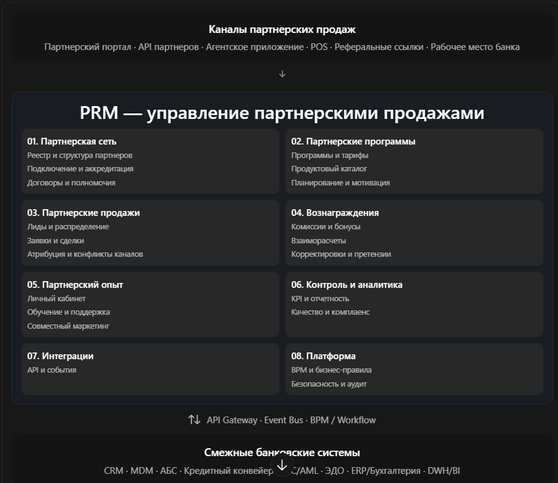

# Partner Relationship Management (PRM) Работа с партнерами

- [Partner Relationship Management (PRM) Работа с партнерами](#partner-relationship-management-prm-работа-с-партнерами)
	- [Зачем](#зачем)
	- [Функции](#функции)
	- [TODO](#todo)
	- [Use case](#use-case)
	- [Границы ответственности PRM и смежных систем](#границы-ответственности-prm-и-смежных-систем)
	- [Ключевые показатели эффективности](#ключевые-показатели-эффективности)
	- [Технологии](#технологии)

## Зачем

[Класс систем](../system.class.md) PRM - функциональный домен [CRM](../crm.md), предназначенный для управления партнерской сетью банка, привлечением клиентов через партнеров, совместными продажами, партнерскими программами и вознаграждениями.

## Функции

[Модули-Функции](https://docs.google.com/spreadsheets/d/1MtpxDRI4N_exJC_ruzgwtBolqQdlrbPGwBrYxE9QVjM/edit?usp=sharing)

## TODO

- [ ] CPC CPA

## Use case

Основные сценарии партнерских продаж в банке:

Модель	Пример	Особенности

- Реферальные продажи - Партнер передает банку потенциального клиента на РКО: Регистрация лида, атрибуция, вознаграждение
- Агентские продажи	- Агент привлекает клиентов на кредитные продукты: Регистрация заявок, контроль статусов, комиссия
- POS-кредитование - Магазин оформляет заявку покупателя на кредит: Интеграция с POS, скоринг, решение, выдача
- Дилерские продажи - Автодилер оформляет автокредит: Партнерская заявка, субсидии, специальные программы
- Ипотечные партнеры - Застройщик или агентство недвижимости направляет ипотечных клиентов: Партнерские условия, заявки, контроль сделок
- Marketplace / Embedded Finance - Финтех-сервис предлагает банковский продукт через API: API-продажи, цифровая атрибуция, Revenue Share
- Корпоративное партнерство	- Бухгалтерская компания привлекает клиентов МСБ: Партнерские предложения, планы продаж, мотивация

## Границы ответственности PRM и смежных систем

В банковской архитектуре важно не дублировать клиентские данные, продуктовые процессы и финансовый учет.

Данные / процесс - Рекомендуемая мастер-система:

- Карточка и структура партнера -	PRM либо корпоративный MDM
- Договоры с партнерами - СЭД / CLM; PRM хранит ссылки и условия
- Партнерские программы - PRM
- Лиды и атрибуция - CRM / PRM
- Клиентские мастер-данные - MDM / АБС
- Кредитные и продуктовые заявки - Продуктовый конвейер
- Открытие счетов, выдача кредитов - АБС / продуктовая система
- Правила комиссий и начисления - PRM / Commission Engine
- Бухгалтерский учет и выплаты - ERP / АБС
- Финансовая и управленческая аналитика - DWH / BI
- Аутентификация пользователей - IAM / SSO
- Документы и электронные подписи - ЭДО / СЭД

Особенно важно выделить __Commission Engine__ как самостоятельный логический компонент, даже если физически он реализован внутри CRM. Его расчеты должны быть воспроизводимыми, учитывать версии правил, исходные события, корректировки и повторную обработку сообщений.

## Ключевые показатели эффективности

KPI - Метод расчета:

- Активные партнеры -	Количество партнеров с квалифицирующей активностью за период
- Конверсия лидов	- Продажи / квалифицированные лиды × 100%
- Конверсия заявок - Выданные продукты / поданные заявки × 100%
- Среднее время обработки - Среднее время от регистрации до целевого статуса
- Стоимость привлечения (CPA) - Расходы канала / количество привлеченных клиентов
- Доходность партнерского канала - Доходы минус относимые затраты
- Выполнение плана - Фактические продажи / план × 100%
- Доля проблемных продаж - Отмененные, спорные или некачественные продажи / все продажи × 100%

## Технологии

- Salesforce Partner Cloud
- Битрикс24 + приложения
  - [Ровно](https://www.bitrix24.ru/apps/app/rovno_crm.partners/)
  - [Фокрум](https://www.bitrix24.ru/apps/app/fokrum.fokrum_partners/)
- Impartner PRM
