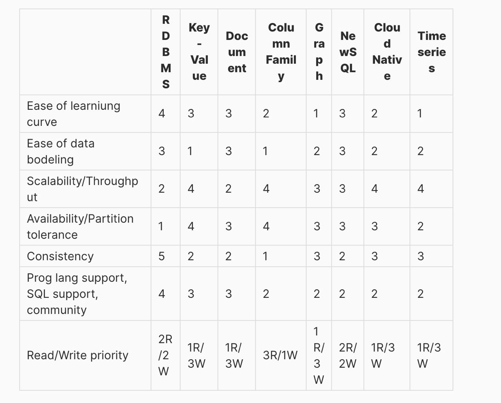
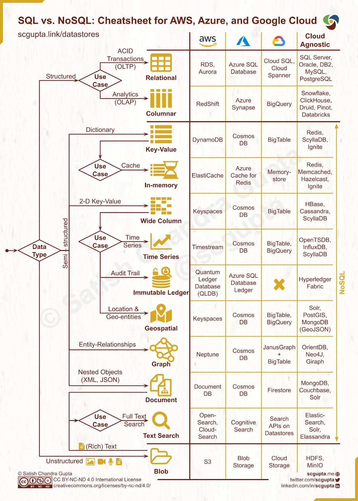
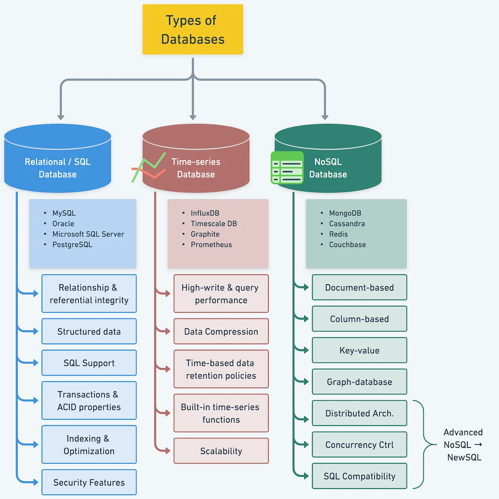

# Хранилища данных

- [Хранилища данных](#хранилища-данных)
  - [Зачем](#зачем)
  - [Виды](#виды)
  - [Критерии выбора](#критерии-выбора)
    - [SQL vs NoSQL](#sql-vs-nosql)
    - [NoSQL](#nosql)
  - [Технологии](#технологии)

## Зачем

- [MS Хранилища данных](https://docs.microsoft.com/ru-ru/azure/architecture/guide/technology-choices/data-store-overview)
- Интегрирует множество источников данных и помогает снизить нагрузку на производственную систему
- Оптимизированные данные для доступа к чтению и последовательного сканирования диска
- Хранилище данных помогает защитить данные от обновлений исходной системы
- Позволяет пользователям выполнять управление основными данными
- Улучшение качества данных в исходных системах

Основные [типы хранилищ](https://yandex.cloud/ru/docs/glossary/datavault
):

- хранилища в третьей нормальной форме (3NF)
- хранилища с измерениями (типа «Звезда» или «Снежинка»)
- хранилища с измерениями [Data Vault](../pattern/system.design/data/data.vault.md)

[Паттерны](../pattern/system.design/data/data.md)

## Виды

[Критерии](../arch.criteria.md)

- __Structured__
  - OLTP (MSSQL..)
    - RDBMS (Relational Database Management System)
      - Almost anything could be solved by them
  - OLAP
    - Column Family (ClickHouse..)
- __Time-series__ database (Prometheus..)
  - Store and manage time-stamped data
- __Semi Structured__
  - [NoSQL](store.nosql.md)
    - Key Value (Redis)
    - Graph database (Neo4J)
    - Document store (MongoDB)
    - Wide column store (Cassandra)
  - __Full text search__ Полнотекстовый поиск (ElasticSearch) - [DSE](dse.md) системы
- __UnStructured__
  - BLOB (Minio)

## Критерии выбора

- [Варианты, TOP](https://db-engines.com/en/ranking)

Решение принимаем по каждому виду данных/бизнес сущности отдельно. Ищем __баланс__ с учетом:

- размера данных
- стоимости их вычисления/чтения с HDD
- вероятности их повторной востребованности
- размера, который они занимают в кэше/частоты изменения данных/того
- насколько "болезненно" будет для пользователя получение "устаревших" данных из __кэша__

### SQL vs NoSQL

- 
- 
- [redis vs PgSQL](https://habr.com/ru/company/cloud_mts/blog/716548/)
- SQL-NoSQL-[TimeSeries](https://towardsdatascience.com/datastore-choices-sql-vs-nosql-database-ebec24d56106)
- 

Критерии:

- __Структура данных__
  - __Semi Structured__ (простые структуры данных, без контроля целостности данных)
    - [Redis](../../technology/store/nosql/redis.md)
  - __Structured__
    - RDBMS
- __Производительность__ Скорость
    - более 100k RPS
      - [Tarantool](../../technology/store/tarantool.md)
    - кэш
      - NoSQL Inmemory Redis
    - до 1000 RPS
      - RDBMS MSSQL
      - RDBMS [PostgreSQL](../../technology/store/sql/postgresql/postgresql.md)
- __Временные данные__
  - NoSQL Inmemory Redis

### NoSQL

- [Clickhouse vs ELK vs Google Big Query и Amazon RedShift vs TimescaleDB](https://habr.com/ru/company/ua-hosting/blog/483112/)
- Memcached vs Redis
  - может показывать отличные результаты производительности в ограниченных окружениях кеширования
  - А при использовании этой системы в [распределённом кластере](https://habr.com/ru/company/wunderfund/blog/685894/) нужны дополнительные настройки. Redis же поддерживает подобные сценарии работы сразу после установки.

## Технологии

[Технологии](../../technology/store/store.md)
