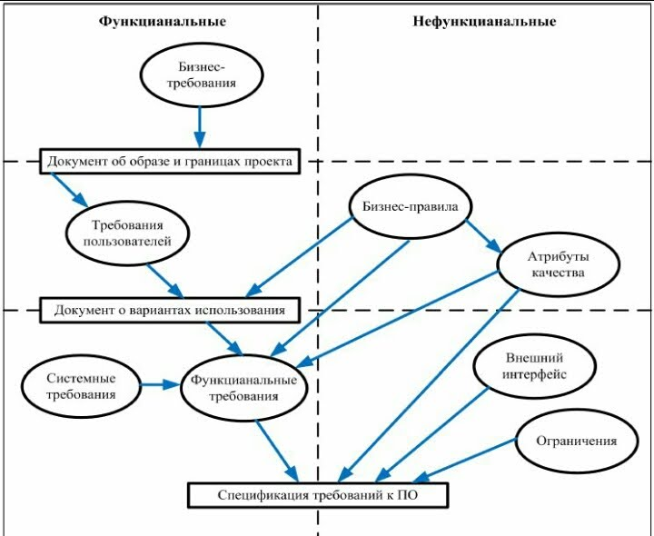

# Checklist Аналитика

- [Checklist Аналитика](#checklist-аналитика)
  - [PP Предпроектная подготовка](#pp-предпроектная-подготовка)
  - [BT Бизнес-требования (БТ)](#bt-бизнес-требования-бт)
    - [AN Нормативная документация](#an-нормативная-документация)
  - [UI-UX Дизайн](#ui-ux-дизайн)
  - [NFR Нефункциональные требования (НФТ)](#nfr-нефункциональные-требования-нфт)
  - [FR Функциональные требования (ФТ)](#fr-функциональные-требования-фт)
  - [ADR Архитектура](#adr-архитектура)
  - [SRS Технический дизайн (ТД)](#srs-технический-дизайн-тд)
  - [DEV Разработка](#dev-разработка)
  - [ОПЭ](#опэ)

## PP Предпроектная подготовка

Шаблон [BDR](../../analytic/template/brd.md):

- Бизнес цели (БЦ)
  - [Impact mapping](../../analytic/ba/analytica.bt.md#карта-влияния-impact-mapping)
- [Стейкхолдеры](https://systems.education/requirements-never-changes) (кто принимает решение)
- Критерии готовности, успешности решения\проекта

Регламенты:

- Эксперты
- Команда, роли
- Существующая инфраструктура, ит-ландшафт
- Бюджет (эконом, mvp или сразу качественно, масштабируемо)
- Связь с заказчиком, формат работы

## BT Бизнес-требования (БТ)

Шаблон [BDR](../../analytic/template/brd.md):

- Проблемная (предметная) область (domain)
  - [Customer Journey Map](../../analytic/ba/cjm.md) (CJM)
- Бизнес правила
- Бизнес требования пользователей для достижения БЦ в контексте БП - __ЧТО надо бизнесу__
- Ограничения, Допущения
  - Границы проекта (scope)\системы\решения (что включаем в автоматизацию на текущем этапе)
    - Приоритеты определены по [MoSCoW](../../analytic/moscow.md)
  - Бэклог
  - Этапы (MVP), Фазы
- Риски: вероятность, шаги минимизации

Шаблон [SRS](../../analytic/template/srs.md):

- [Бизнес процессы (БП)](../../analytic/ba/bp.md) AS-IS, TO-BE
- Детальные бизнес требования:
  - [Event Storming](../../analytic/sa/event.storming.md)
  - User Story [US](../../analytic/ba/user.story.md)
    - [Критерии приемки](../../analytic/ba/user.story.md#acceptance-criteria)
    - Требования к [запуску](../../analytic/ba/user.story.md#definition-of-done) (DoD)
  - [User Stoty Map](../../analytic/ba/user.story.md#user-story-map)
  - UC [use-case](../../analytic/sa/use.case.md), клик-событие, акторы
  
### AN Нормативная документация

Шаблон [SRS](../../analytic/template/srs.md):

- Термины
- SLA
- Нормативно правовые акты (НПА)

## UI-UX Дизайн

- [Reference Примеры](../../analytic/design.ui/ui-ux.md#reference) конкурентов
- Прототип mocks, [wireframe](https://practicum.yandex.ru/blog/chto-takoe-vajrfrejmy/) — упрощенный прототип интерфейса
  - Карта экранов (ЭФ) - переходов
  - __Интерактивный прототип__ (эмуляция UX)
    - Figma Prototype
  - Инструменты
    - Figma
    - Camunda Modeler Form
    - [PlantUML Salt](https://plantuml.com/ru/salt)
- Deploy for [Demo](../../analytic/design.ui/ui-ux.md#технологии)
- [Дизайн система](../../analytic/design.ui/ui-ux.md#дизайн-система)
  - [UI Kit](../../analytic/design.ui/ui-ux.md#ui-kit)
    - Загрузка файлов
    - Скачать
    - Груповой выбор
- Детальное описание в ТД [SRS](#srs-технический-дизайн-тд)

## NFR Нефункциональные требования (НФТ)

По архитектурным [атрибутам качества](../../arch/ability/arch.ability.md):

- Надежность
- Наблюдаемость
  - Протоколирование и бизнес мониторинг
- Безопасность
  - ИБ (ПДН ФЗ-152)
- Производительность
- Сопровождаемость

## FR Функциональные требования (ФТ)

__по ИС__ - функции ИС - __ЧТО ИС должна__ уметь делать для выполнения БЦ, БП, БТ:

Шаблон [RFI](../../analytic/template/rfi.md)

- Анализ существующих Функциональных возможностей ИС

Шаблон [RFP](../../analytic/template/rfp.md)

- Выбор поставщика готового решения

Шаблон [FRD](../../analytic/template/frd.md):

- Функциональные требования

Шаблон [SRS](../../analytic/template/srs.md):

- DB Доменная модель
  - Доменные объекты (Бизнес Сущности): Аттрибуты, Правила валидации, Связи
  - Статусная модель
  - Доменные события
  - [Инварианты агрегата](../../arch/pattern/system.design/ddd.md#агрегат-aggregate-root)
  - Проверка на полноту: [CRUD LSHAX](https://systems.education/requirements-never-changes)
- Алгоритмы Процессы
- Отчетность
  - ПФ, Макросы
- Регулярные процессы (по расписанию)
- Мониторинг, администрирование, обслуживание
- Справочники
- Настройки (UC, FT, Название, Назначение, Значение по умолчанию)
- Метрики
- Прикладная защита (ABAC и тп)
  - Ролевой доступ RBAC

## ADR Архитектура

[Архитектура](../arch/arch.md)

## SRS Технический дизайн (ТД)

[__КАК надо сделать ФТ__](../../analytic/sa/sa.md#постановка-задачи-пз---технический-дизайн-тд) (ТД)

Шаблон [SRS](../../analytic/template/srs.md):

- Операции обработки данных, функции
- Интеграции
  - События, Команды, Запросы
    - Входящие\исходящие
  - [API](../../api/api.md)
  - Схемы взаимодействия (SQD)
- Детальный UI UX на основе [прототипов и дизайн системы](#ui-ux-дизайн)
  - [Спецификация ЭФ](../../analytic/design.ui/ui-ux.md)
  - Реестры, Справочники, Отчеты
  - Фильтрация
  - ЭФ, Карта экранов
    - Шаблон описания: Элементы (кнопка, checkbox и тп), Действия, Видимость, Доступность, Обязательность, Правило валидации, Возможные значения, Значение по умолчанию, Источник данных
- База данных: ХП, функции, таблицы
- Локализация
- Проверка на [полноту требований](https://systems.education/requirements-never-changes)
  - UC Контекстный анализ
  - Маппинг ФТ на ТД: Связь потребностей (UC), требований (FT) и решений (TD)

## DEV Разработка

- Грумминг, обсуждение с разработчиками
- Консультации на этапе реализации

## ОПЭ

- Демо
  - от разработчиков\тестеров
  - заказчику
- Консультации на этапе ОПЭ
- Документация для передачи в эксплуатацию:
  - [РП](../../analytic/template/manual.md)
  - мониторинг, метрики, логи
  - [описание ИС](../../analytic/template/is.md)
- Актуализация документации: ПЗ, ТД, API, РИПВ
