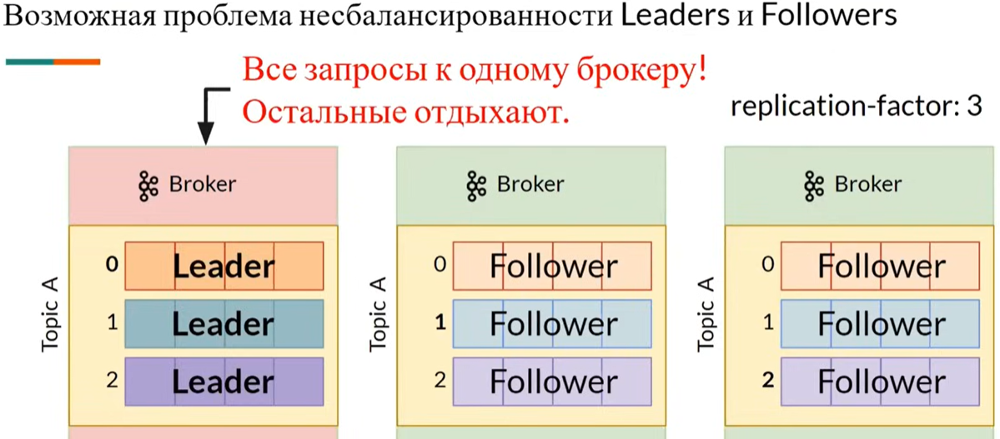
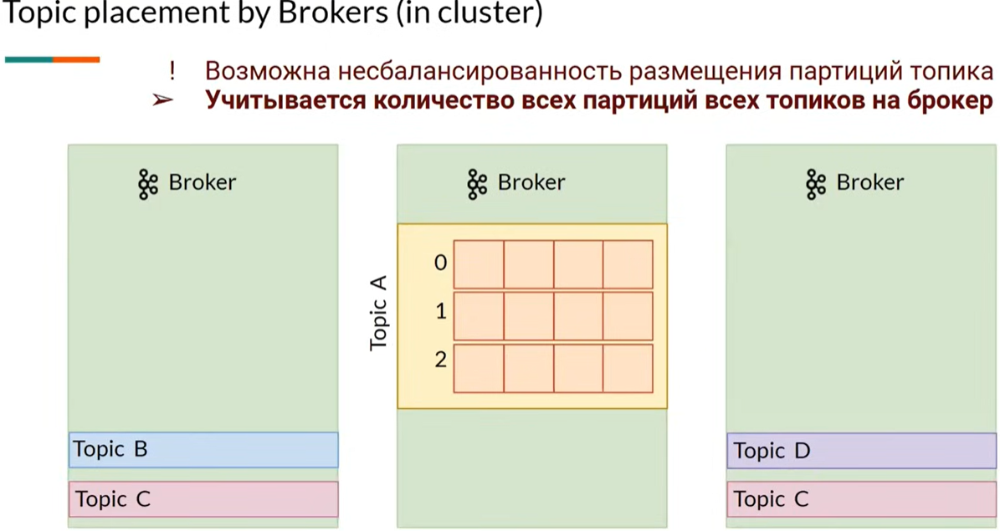
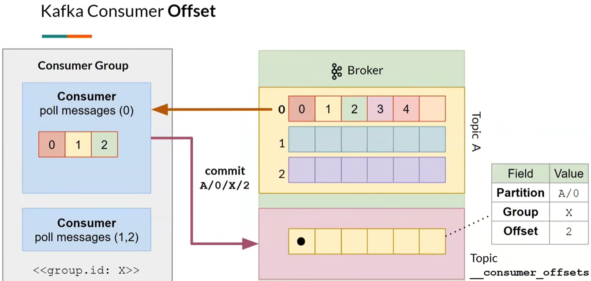
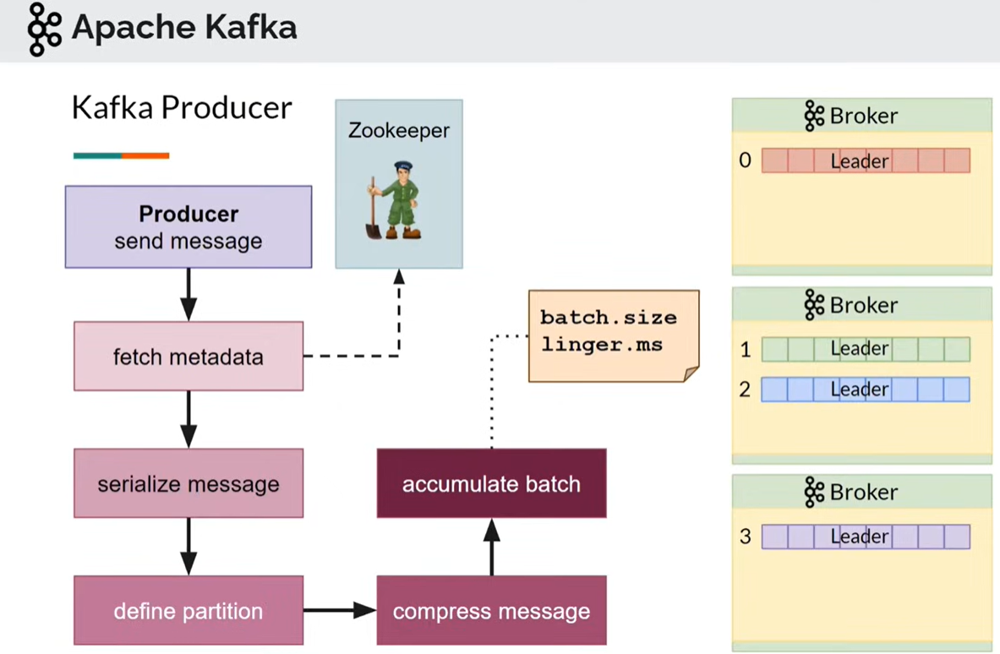

# Kafka

- [Kafka](#kafka)
  - [Зачем](#зачем)
  - [Плюсы и минусы](#плюсы-и-минусы)
  - [Функции](#функции)
  - [Основные компоненты](#основные-компоненты)
    - [Продюсеры (Producers)](#продюсеры-producers)
    - [Потребители (Consumers)](#потребители-consumers)
    - [Топики (Topics)](#топики-topics)
    - [Партиции (Partitions)](#партиции-partitions)
    - [Брокер (Broker)](#брокер-broker)
    - [Кластер (Cluster)](#кластер-cluster)
  - [Паттерны](#паттерны)
  - [Модель](#модель)
  - [Deployment](#deployment)

## Зачем

Реализация [паттерна интеграции](../../../arch/pattern/integration/pattern.integration.md) [Message Broker](../../../arch/pattern/integration/pattern.messagebroker.md).

[Критерии выбора](../../../arch/pattern/integration/pattern.messagebroker.md#критерии-выбора).

UC:

- большие данные [BigData](../../../arch/style/bigdata.md) и __потоковую обработку Streaming Data__
- Log processing and analysis
- Data streaming in recommendations
- System monitoring and alerting
- CDC (Change data capture)
- System migration

## Плюсы и минусы

Плюсы:

- __распределенный__ горизонтально __масштабируемый__
- __отказоустойчивый__ журнал коммитов
  - __кластер__ [серверов](https://www.youtube.com/watch?v=-AZOi3kP9Js)
  - __Шардинг__ из коробки
- Поток событий
- __согласованность__ данных
  - __репликация__ топиков (replication-factor) 
    - master-slave (Leader-Follower)
    - возможна задержка в данных. Запись сообщений всегда в Leader. Follower получает pull от Leader сообщения периодически
    - in-sync replicas (ISR) - синхронная запись в Follower partition, замедляют запись сообщений
- Strict __message ordering__ (FIFO) by partition
- Message retention for extended periods, including the possibility of __replaying past messages__
  - Сообщения в Kafka __не удаляются брокерами по мере их обработки консьюмерами__ — данные в Kafka могут храниться днями, неделями, годами
  - Благодаря этому одно и то же __сообщение может быть обработано сколько угодно раз__ разными консьюмерами и в разных контекстах
- Группировка сообщений в пачки
- транзакции между несколькими топиками

Минусы:

- Наиболее полно __API Kafka поддерживается только в языках Java и Scala__. В других языках поддержка не всегда полная, поэтому фреймворки Kafka Connect и Kafka Streams созданы.
- [Нет приоритета сообщений](https://blog.bytebytego.com/p/how-to-choose-a-message-queue-kafka)
- к минусам модели Pull можно отнести потенциальную __разбалансированность нагрузки__ между разными консьюмерами и __более высокую задержку__ [обработки данных](https://vc.ru/dev/869548-kafka-vs-rabbitmq-chto-nuzhno-znat-analitiku-pro-brokery-soobshenii)
- __разбалансировка партиций по брокерам кластера__, может требоваться ручная балансировка по брокерам больших партиций

## Функции

Фундаментальное [отличие Kafka от брокеров очередей](https://slurm.io/tpost/pnyjznpvr1-apache-kafka-osnovi-tehnologii) состоит в том:

- как __сообщения хранятся__ на брокере, но есть ttl 
  - Сообщения в Kafka организованы и хранятся в именованных __топиках (Topics)__, каждый топик состоит из одной и более __партиций (Partition)__, распределённых между брокерами внутри одного кластера.
- как __потребляются консьюмерами__ (consumer)
  - используется __подход pull__ (в RMQ push по умолчанию): __консьюмеры сами отправляют запросы__ в брокер раз в n миллисекунд для получения новой порции сообщений
    - позволяет __группировать сообщения в пакеты (batch)__, достигая лучшей пропускной способности
  - Консьюмеры
    - отмечают (__commit__) обработанные сообщения с помощью оффсетов. __Оффсет__ (Offset) – это номер сообщения в партиции 
      - либо об успешной обработке (offset-commit)
      - либо об ошибке (offset-reset)
    - type of commit
      - auto commit - сразу после получения сообщения, до обработки: at most once (риск miss message)
      - manual commit - после обработки сообщений: at least once (риск duplicate message)
      - custom offset managment: exactly once
    - consumer group - __параллельное чтение__ данных из partition
- __produce__ [публикация сообщений](https://www.youtube.com/watch?v=-AZOi3kP9Js) 
  - acks - гарантия доставки, ожидание подтвеждения
    - 0 нет
    - 1 only Leader
    - -1 all ISR
  - [delivery semantic](https://habr.com/ru/articles/738874/)
    - at most once (не более одного)
    - al least once (хотя бы один)
    - exactly once (idempotent)
  - serialize
  - define partition:
    - explicit partition
    - round robix
    - key
  - compress
  - accumulate batch

## Основные компоненты

### Продюсеры (Producers)

1) Генерируют сообщения/события к обработке и отправляют в топики (темы).
2) Определяют, в какую партицию топика записывать данные: автоматически или по заданным правилам.
3) Могут быть чем угодно: микросервисы, устройства IoT и другие приложения.
4) Поддерживают режимы отправки:
   - Синхронный — ждёт подтверждения от Kafka перед отправкой следующего сообщения.
   - Асинхронный — отправляет сообщения без ожидания ответа.
5) Могут гарантировать доставку с разными уровнями подтверждения (acks):
   - acks=0 — без ожидания подтверждения (возможна потеря данных, высокая скорость).
   - acks=1 — подтверждение только от лидера партиции (среднее).
   - acks=all — подтверждение от всех реплик (максимальная надёжность).

### Потребители (Consumers)

1) Подписываются на один или несколько топиков и получают сообщения/события.
2) Могут работать как отдельные клиенты или объединяться в группы (Consumer Groups) для параллельной обработки сообщений.
3) В группе консьюмеров каждый участник обрабатывает свою часть партиций.
4) Kafka гарантирует, что каждое сообщение будет обработано хотя бы одним потребителем в группе.
5) Модели доставки сообщений:

- at-least-once — как минимум 1 раз, возможны дубликаты.
- exactly-once — ровно один раз.

### Топики (Topics)

Логическая тема, куда продюсеры отправляют сообщения, а потребители их читают

1) Логическая категория или тема, куда Продюсеры отправляют сообщения, а Потребители их читают.
2) Представляют собой поток сообщений, где каждое имеет: ключ, значение, метаданные.
3) Не удаляют сообщения сразу после обработки — данные хранятся в топике в течение заданного времени.
4) Могут быть разделены на партиции, что позволяет распределять нагрузку между Продюсерами и Консьюмерами.

### Партиции (Partitions)

Подмножество данных внутри топика, которое позволяет распределять нагрузку и масштабировать обработку сообщений. Каждый топик состоит из одной или нескольких партиций

1) Каждый топик состоит из одной или нескольких партиций (разделов).
2) Сообщения внутри партиции хранятся в строгом порядке (FIFO — "первым пришёл, первым обработался").
3) Разные партиции могут обрабатываться параллельно, что увеличивает производительность Kafka.
4) Каждое сообщение в партиции получает уникальный порядковый номер (offset), который используется Потребителями для чтения данных.
5) Продюсеры могут отправлять сообщения в партиции автоматически или по определённому ключу (например, все заказы одного клиента попадут в одну партицию).
6) Один потребитель из Группы Консьюмеров читает данные только из своей партиции, что позволяет распределять нагрузку.
7) Повышение надежности обеспечивается через репликацию: выделяют Leader Replica (основная копия данных партиции) и Follower Replica (копирует данные лидера в синхронном или асинхронном режиме).

### Брокер (Broker)

сервер Kafka, который отвечает за хранение, управление и передачу данных внутри кластера

1) Хранят топики и их партиции.
2) Обрабатывают запросы Продюсеров на запись и Консьюмеров на чтение данных.
3) Управляют репликацией партиций для отказоустойчивости.
4) Автоматически перераспределяют нагрузку при добавлении новых брокеров в кластер.

### Кластер (Cluster)

группа брокеров, работающих вместе для масштабирования и распределённой обработки данных

1) Это группа брокеров, работающих вместе для масштабирования и распределённой обработки данных.
2) Использует ZooKeeper или KRaft для координации (назначает лидеров партиций, отслеживает состояние брокеров).
3) Позволяет добавлять новые брокеры без остановки системы.
4) Поддерживает автоматическое восстановление при сбоях отдельных узлов.

## Паттерны

- Один producer создается для отправки сообщений для быстродействия (fetch metadata sync тяжелая операция)

## Модель

Каждое сообщение (event или message) в Kafka состоит из:

- ключа
- значения
- таймстампа
- и опционального набора метаданных (так называемых хедеров)

[TODO](https://slurm.io/tpost/pnyjznpvr1-apache-kafka-osnovi-tehnologii)

## Deployment

- docker
  - todo [java](https://habr.com/ru/articles/738874/)
  - [.net core](https://mandur.hashnode.dev/kafka-for-aspnet-core-6)
- using Kafka via UI
  - Conduktor
  - KafkaTool
  - Kafdrop
